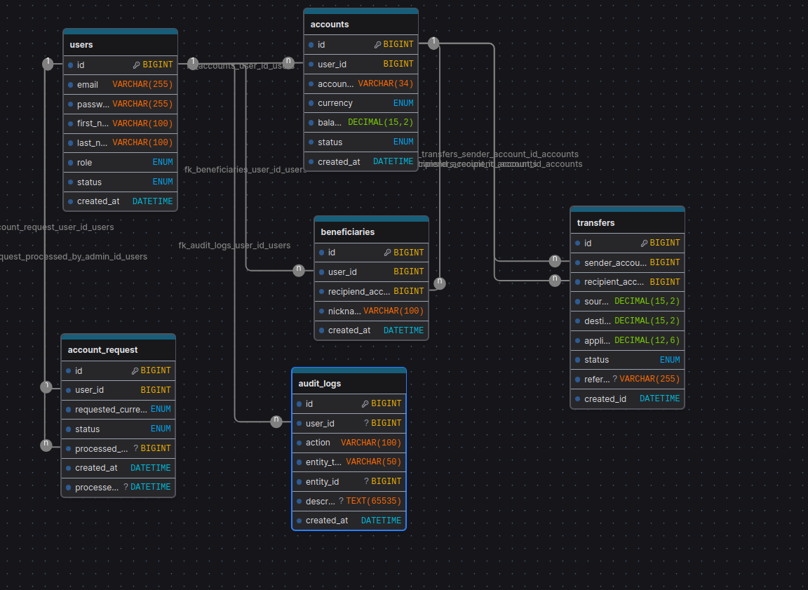
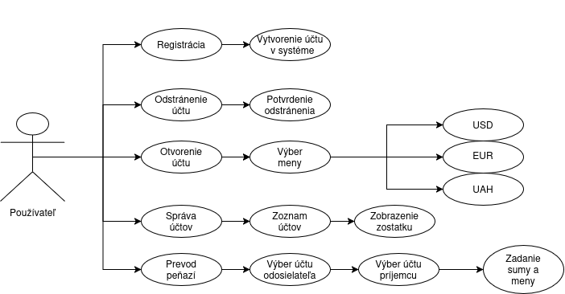

# FinCare

## Popis:

Náš projekt **FinCore** predstavuje pohodlnú mobilnú bankovú aplikáciu na správu financií. Každý používateľ si môže zaregistrovať vlastný účet a v prípade potreby ho odstrániť. Aplikácia umožňuje otvárať bankové účty v troch menách: amerických dolároch (USD), eurách (EUR) a ukrajinských hrivnách (UAH). Používatelia môžu spravovať svoje účty a sledovať aktuálny zostatok. Aplikácia tiež umožňuje prevádzať peniaze medzi účtami, a to aj v rôznych menách.

## Okná a funkčnosť:

1. Prihlásenie a registrácia
2. Osobné údaje
3. Prevod peňazí
4. Zoznam príjemcov
5. Účty
6. Nastavenia
7. Admin panel

## ER diagrama:

## UML diagrama:

## Architektúra projektu:

Naša aplikácia bude využívať JavaFX ako frontend na spracovanie a zobrazenie údajov a bude odosielať požiadavky na údaje na backend. Backend bude vytvorený pomocou Spring Boot a bude spracovávať požiadavky, spravovať bankovú logiku a riadiť autentifikáciu. Ako databázu budeme používať MySQL.